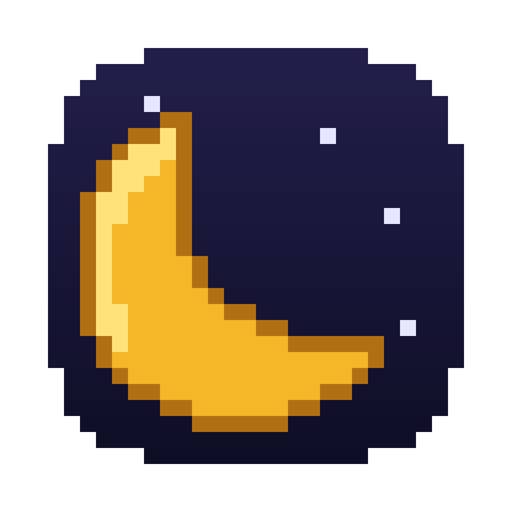

<p align="center">
  
</p>

<h1 align="center">LaLune Dorée Emulator</h1>

<p align="center">A free, open-source Game Boy Advance emulator for macOS.<br>
<em>La lune dorée</em>.

<p align="center">
  <a href="https://raw.githubusercontent.com/IILalune/LaluneDorree-Emulator/refs/heads/main/release/LaLuneDoree-macOS.dmg">
    
  </a>
  <br>
  <sub>Version 1.02 · macOS 11 or later · Apple Silicon and Intel · 1.76 MB</sub>
</p>

---

LaLune Dorée Emulator runs Game Boy Advance games on your Mac. It's written from scratch in C++20:
the game's original machine code runs on an emulated ARM7TDMI CPU, and the graphics, sound, timers,
and save chips are reimplemented in software. You don't need a copy of Nintendo's BIOS, because the BIOS
functions are reimplemented in C++ too.

It's also meant to be read. Every source file starts with a plain-English explanation of the hardware
it models, so it doubles as a guide to how the GBA works.

## Features

- **Game library** with thumbnails. Add games by drag-and-drop or from a file picker.
- **HD video filters** that upscale the 240x160 screen, up to 1920x1280 with Super HD.
- **Battery saves** (EEPROM and SRAM) written automatically while you play.
- **Save states**: save at any moment and go back to any earlier one, with a screenshot of each.
- **PS5 DualSense controller** support over USB-C or Bluetooth, plus full keyboard controls.
- **Fast-forward** at up to 8x, and **slow motion** at half speed.
- **Full screen** and resizable windows, with sharp whole-number scaling or fill-the-window.
- **A dreamy night-sky look** that matches the golden moon icon: twinkling stars, drifting
  pixel-art clouds, gold highlights, and a short intro where the moon rises (press any key to skip).
- **Native macOS** touches: sharp Retina text, system file dialogs, and drag-and-drop.

## Install

1. Download **[LaLuneDoree-macOS.dmg — Version 1.02](https://raw.githubusercontent.com/IILalune/LaluneDorree-Emulator/refs/heads/main/release/LaLuneDoree-macOS.dmg)** (1.76 MB) and double-click it.
2. In the window that opens, drag **LaLune Dorée Emulator** onto the **Applications** folder.
3. Eject the "LaLune Dorée Emulator" disk in Finder, and delete the `.dmg` if you like.

The app needs nothing else installed. It runs on macOS 11 (Big Sur) or later, on both Apple
Silicon and Intel Macs.

### Opening it the first time

LaLune Dorée Emulator is a free project and isn't signed with a paid Apple Developer ID, so the
first time you open it, macOS says it can't verify the app. You only have to allow it once:

- **macOS 15 (Sequoia) or later:** open the app, click **Done** in the warning, then go to
  **System Settings > Privacy & Security**. Scroll down to the Security section, click **Open Anyway**
  next to the message about LaLune Dorée Emulator, and confirm with your password or Touch ID.
- **macOS 14 (Sonoma) or earlier:** in your Applications folder, Control-click (or right-click)
  **LaLune Dorée Emulator**, choose **Open**, then click **Open** again.

After that it opens normally, like any other app.

### Where your games go

The installed app keeps its library in a `Games` folder inside its sandbox folder (see
[Security and privacy](#security-and-privacy)). Add games by dragging `.gba` files onto the app's
window, or with **Insert Game…** / **Add ROMs…**. To copy files in with Finder, click
**Open Folder** in the library. You can pick a different folder under Settings > Games folder.

### Security and privacy

ROMs from the internet can be made to attack emulators, so the app is built to keep them boxed in:

- **No internet.** The app never connects to anything and collects no data.
- **App Sandbox.** macOS shuts the installed app in its own folder,
  `~/Library/Containers/dev.lalunedoree.emulator/`. Outside it, the app can only open files and
  folders you pick or drag onto it. It can't see your documents, photos or other apps, or use the
  camera or microphone.
- **Hardened runtime.** macOS stops other programs from injecting code into the app.
- **Memory checks.** If a ROM triggers a bug that would read or write outside the emulator's
  memory, the app stops instead.

The first time you open this version, macOS moves your saves, settings and games from
`~/Library/Application Support/LaLuneDoree/` into the sandbox folder. If you'd picked your own
games folder, pick it again under Settings > Games folder so the app is allowed to open it.

## Build from source

You only need this if you want to change the code. Otherwise, use the download above.

Requirements:

- macOS 11 (Big Sur) or later.
- Xcode Command Line Tools: `xcode-select --install`
- [Homebrew](https://brew.sh), then CMake and SDL2: `brew install cmake sdl2`

Steps:

1. Get the source: download it as a ZIP from the repository page and unzip it, or clone it with `git`.
2. Open Terminal in the project folder and build:

   ```sh
   cmake -S . -B build          # configure (Release build by default)
   cmake --build build -j8      # compile -> build/LaLuneDoree.app
   ```

3. Put your `.gba` files in the `games/` folder.
4. Start the app:

   ```sh
   open build/LaLuneDoree.app
   ```

   An app you build yourself reads games from this project's `games/` folder, unless you choose
   another one in Settings. It also needs Homebrew's SDL2 to stay installed. To make an app you can
   give to other people, build the DMG instead (see [Making the DMG](#making-the-dmg)).

macOS may ask once for permission to access the folder the project is in (for example Desktop or
Documents). Allow it so the app can read your games.

## Getting games

**No games are included, and none will be provided.** Commercial GBA games are copyrighted. Only
play games you have the right to use, such as:

- backups you made yourself from cartridges you own, or
- homebrew and freely licensed games, made by people who share them for free.

Please don't open issues asking where to download ROMs.

## Using the app

### The library

- If your games folder has games, the app opens on your library. Pick one and press Return (or ✕).
- If it's empty, the app asks you to insert a game. Click **Insert Game…** or drag a `.gba` file onto the window.
- Games you add from inside the app are copied into the games folder, so you can delete the originals.
- Files you copy into the folder in Finder (**Open Folder** in the library) appear the next time the
  app opens or you return to the library.

### Settings

Open Settings with the **Settings** button or `,` in the library, **Create** on a PS5 controller,
or from the pause menu while you're playing. Changes apply right away.

| Setting | Options |
|---------|---------|
| Volume | Muted, 10–100% |
| Fast-forward speed | 2x, 3x, 4x, 6x, 8x |
| Video filter | Pixel perfect, Smooth HD, Cinematic HD, Retro LCD, Super HD, Retro CRT, LCD Bloom |
| Screen scaling | Whole-number (sharpest) or Fill window |
| Full screen | On / Off (remembered between launches) |
| Controls | Opens the Controls screen (see [Changing the controls](#changing-the-controls)) |
| Menu confirm button | Cross ✕ (PlayStation style) or Circle ○ (Nintendo position) |
| Games folder | Choose where your games are kept |

Use ← → to change a value, Return / ✕ to select, and Esc / ○ to go back. With a mouse, click the
‹ › arrows or the row itself.

### Video filters

Press **V** while playing to switch to the next filter, or **Shift+V** to go back.

| Filter | What it does | Output |
|--------|--------------|--------|
| Pixel perfect | Sharp square pixels, like the original screen | 240x160, enlarged |
| Smooth HD | xBR: redraws staircase edges as smooth lines and curves | 960x640 |
| Cinematic HD | Smooth HD plus richer colour, a soft glow, and a vignette | 960x640 |
| Retro LCD | Big pixels with the grid lines of a handheld screen | 960x640 |
| Super HD | Super-xBR in three 2x steps: each new pixel is blended along the edges around it, so the art looks redrawn at high resolution | 1920x1280 |
| Retro CRT | A 90s TV: curved glass with rounded corners, scanlines that glow wider on bright colours, RGB phosphor stripes, colour fringes toward the edges, bloom, and a vignette | 960x640 to 1440x960, matched to the window |
| LCD Bloom | Retro LCD where every pixel glows: brightest in the middle of its cell, with light spilling over the grid lines and bright areas blooming outward | 960x640 |

Super HD uses all CPU cores and takes about 8–9 ms per frame on an M2, which fits within 60 fps. If
a game slows down on your Mac, use Smooth HD instead.

### Controls

These are the default controls. You can change all of them except the pause menu, full screen and
window size keys (see below).

| GBA          | Keyboard                 | PS5 DualSense controller        |
|--------------|--------------------------|---------------------------------|
| D-pad        | Arrow keys               | D-pad / left stick              |
| A            | X                        | Cross ✕                         |
| B            | Z                        | Square □ or Circle ○            |
| L / R        | A / S                    | L1 or L2 / R1 or R2             |
| Start        | Return                   | Options                         |
| Select       | Backspace or Right Shift | Create                          |
| Fast-forward | Hold Tab                 | Hold touchpad click             |
| Slow motion  | `` ` `` (toggle)         | R3, right stick click (toggle)  |
| Quick save state | F5 or ⌘S             | L3, left stick click            |
| Quick load state | F8 or ⌘L             |                                 |
| Pause menu   | Esc                      | PS button or mic button         |
| Full screen  | F or F11                 |                                 |
| Window size  | 3–6 (3x to 6x)           |                                 |

In the library, a controller can also use △ to add games and □ to open the games folder. To pair a
DualSense over Bluetooth, hold **Create** + **PS** until the light bar flashes, then connect it in
System Settings > Bluetooth.

Only the PS5 DualSense is supported. SDL may detect other controllers, such as Xbox pads, but the
button mapping and on-screen prompts (✕ ○ □ △) are made for PlayStation and haven't been tested
with anything else.

The PS button opens the emulator's pause menu. The first time you use a controller, macOS asks
whether LaLuneDoree may "override the system behavior" of the home button:

- **Allow**: the PS button opens the emulator's pause menu instead of the Games overlay or Spotlight.
  This only applies while the emulator is the app in front. When you switch to another app or quit
  the emulator, the PS button works as usual again. Nothing else on your Mac changes.
- **Don't Allow**: the PS button keeps opening the Games overlay. Esc still opens the pause menu.

The dialog says this also applies to "games launched by LaLuneDoree". GBA games run inside the
emulator itself, so that only means the emulator. It doesn't start any other programs.

### Changing the controls

Open **Settings > Controls**. Each control has two keyboard keys and two controller buttons:

1. Pick a cell with the arrow keys (or the D-pad), or click it.
2. Press Return (or ✕), then press the key or button you want. Esc cancels.
3. Backspace (or △) clears the selected cell.

A key or button can only do one thing, so assigning it moves it from wherever it was before, and
a message says so. **Reset to defaults** puts everything back. The menus always use the arrow keys,
Return and Esc on the keyboard, and the D-pad, left stick, ✕ and ○ on the controller, so you can't
lock yourself out. The PS and mic buttons always open the pause menu and can't be assigned.

Besides the GBA buttons you can assign:

- **Turbo A** and **Turbo B**: press A or B over and over while held. Nothing is assigned by default.
- **Fast-forward** and **Slow motion**.
- **Quick save state** and **Quick load state** (⌘S and ⌘L always work as well).

Controller options, below the list:

| Option | What it does |
|--------|--------------|
| Left stick as D-pad | On: the left stick moves like the D-pad in games. Off: only the buttons you assign |
| Stick dead zone | How far (10–80%) you push the stick before it counts. Raise it if a worn stick drifts |
| L2 / R2 press point | How far (5–95%) you press L2 or R2 before it counts |
| Turbo speed | 5, 7.5, 10, 15 or 30 presses a second |
| Fast-forward button | Hold, or press once to start and again to stop |

### Save states

A save state is a snapshot of the game at one exact moment. You can keep many of them and go back to
any one, for example to retry a fight from the start of the same room.

- **Quick save** (F5, ⌘S or L3) saves a new state while you play. **Quick load** (F8 or ⌘L) goes
  back to the newest state you saved.
- **Save states…** in the pause menu lists every state for the game, newest first, with its
  screenshot and the time it was made. Pick **Save a new state** to add one, pick any state and
  press Return (or ✕, or double-click it) to load it, and press Backspace (or △) twice to delete it.
- Loading a state first keeps where you were as an **Auto backup** at the top of the list, so you
  can always undo a load.
- The app keeps your 30 newest saved states and 5 newest auto backups per game, and deletes older
  ones when you save more.
- States are separate from the game's own saves. Loading a state never changes your `.sav` file.
- A state only loads into the exact game (and version of it) that made it.

States are kept in a `States/<game code>/` folder next to the saves (see below), about 550 KB each.

### Saves and settings

Saves go to `<game code>.sav` files a couple of seconds after the game saves, and again when you
quit. Settings are in `settings.ini` in the same folder. That folder is
`~/Library/Containers/dev.lalunedoree.emulator/Data/Library/Application Support/LaLuneDoree/` for
the installed app, and `~/Library/Application Support/LaLuneDoree/` for an app you built yourself.
To back up your progress, copy that folder. Files are written to a temporary copy first, so a crash
or a full disk can't leave a broken save behind.

## Compatibility

The CPU, memory, and BIOS test ROMs in `tests/` all pass, and commercial games have been played from
boot into gameplay with sound and saves. Known limitations:

- **Flash saves are not supported yet.** Games that save to Flash memory (common in larger games,
  including the Pokémon series) will run but won't keep their saves. EEPROM and SRAM saves work.
- No link cable or rumble yet.
- macOS only. The emulator core is portable C++, but the app around it uses AppKit.

If a game doesn't work, please open an issue with the game's name and 4-letter code. The library
shows the code when you select a game. Don't attach the ROM.

## Troubleshooting

- **"Apple could not verify LaLune Dorée Emulator is free of malware" or "can't be opened".** See
  [Opening it the first time](#opening-it-the-first-time).
- **The Dock or Finder still shows an old icon.** Run `touch build/LaLuneDoree.app`, or log out and
  back in. macOS caches app icons.
- **`find_package(SDL2)` fails when you configure the build.** Install SDL2 with `brew install sdl2`
  and run the `cmake -S . -B build` step again.
- **No games show up.** Check Settings > Games folder to see which folder the app is reading, and
  make sure the files end in `.gba`.

## For developers

### Project layout

```
src/        emulator core and macOS app
games/      your games when building from source (ignored by git)
release/    the downloadable app: LaLuneDoree-macOS.dmg
tests/      open-source test ROMs (jsmolka/gba-tests, MIT)
tools/      test runner, DMG builder, icon and DMG background generators
assets/     app icon and DMG window background
```

Build options:

```sh
cmake -S . -B build -DGAMES_DIR=/some/folder   # use a different default games folder
```

### Running the tests

```sh
tools/run_tests.sh     # runs every ROM in tests/, screenshots -> build/test-output/
```

Each test ROM shows "All tests passed" on screen, or the number of the first failed test.

### Making the DMG

```sh
tools/make_dmg.sh      # -> release/LaLuneDoree-macOS.dmg
```

The script builds an app that's different from your everyday `build/` one:

- SDL2 is downloaded (checked against its published SHA-256), built, and linked into the app, so
  people don't need Homebrew.
- It's a universal app (Apple Silicon + Intel) that runs on macOS 11 or later.
- It runs in the App Sandbox (permissions in `assets/LaLuneDoree.entitlements`) with the hardened
  runtime. `assets/container-migration.plist` moves older versions' data into the sandbox.
- Games are kept in the `Games` folder next to the saves.
- The DMG opens on a window with the app, an Applications shortcut, and a golden arrow between them.
  The script asks Finder to lay out that window, so the first time you run it macOS may ask you to
  let Terminal (or your editor) control Finder. Allow it.

The first run takes a minute or two to build SDL; later runs reuse it. When you change the code,
run the script again and commit the new DMG. Keep the file name the same: the download links in
this README point to it.

To change the DMG window's background, edit `tools/make_dmg_background.py` and run it to regenerate
`assets/dmg-background.tiff`.

### Headless mode

You can run the emulator without a window, which is handy for debugging and automated checks:

```sh
build/LaLuneDoree.app/Contents/MacOS/LaLuneDoree games/yourgame.gba \
    --headless 600 --dump out.bmp --dump-every 100 --press 100:a,500:start --save test.sav
```

| Option | Meaning |
|--------|---------|
| `--headless N` | Run N frames as fast as possible, then exit |
| `--dump file.bmp` | Save a screenshot of the last frame |
| `--dump-every N` | Also save a screenshot every N frames |
| `--press F:key,...` | Press buttons at given frames (`a b l r start select up down left right`) |
| `--save file.sav` | Load this save file first and write it back at the end |
| `--filter N` | Run the final screenshot through a video filter (0–6, in the order of the table above) |
| `--load-state file.state` | Load this save state before running |
| `--save-state file.state` | Write a save state after the last frame |

Save states make a good check that emulation is repeatable: running 600 frames, saving a state, and
then running 300 more frames from it gives the same screenshot as running 900 frames in one go (with
`--press` frames shifted by 600).

To check the menus after changing how they look, draw every screen (intro, library, empty library,
settings, the pause menu and Save States) into BMP files, at 960x640 and at the smallest window size, without
opening a window:

```sh
build/LaLuneDoree.app/Contents/MacOS/LaLuneDoree games/yourgame.gba --ui-dump build/ui
```

With a ROM, the library shows that ROM's folder and the pause menu is drawn over the game. Nothing
is saved, apart from a few example states in a `states/` folder inside the dump folder.

### How the code is organised

Read the files roughly in this order. Each one starts with a comment explaining the hardware it models.

| File | What it emulates | C++ ideas worth noticing |
|------|------------------|--------------------------|
| `common.hpp` | Shared types and helpers | fixed-width integers, `constexpr`, templates, `memcpy` for safe type punning |
| `gba.hpp/.cpp` | The console and the main loop | composition, references between objects, constructor initialiser lists |
| `bus.hpp/.cpp` | Memory map and I/O registers | `std::array`, templates with `if constexpr`, explicit template instantiation |
| `cpu.hpp/.cpp` | ARM7TDMI registers, modes, interrupts | bit manipulation, `static constexpr` members, private helpers |
| `cpu_arm.cpp` | 32-bit ARM instructions | decoding via bit masks, lambdas, `std::popcount` |
| `cpu_thumb.cpp` | 16-bit Thumb instructions | sign extension with casts and shifts |
| `bios.hpp/.cpp` | System calls (division, decompression...) | `std::vector`, replacing hardware with C++ (HLE) |
| `ppu.hpp/.cpp` | Graphics: tiles, sprites, rotation, blending | nested structs, fixed-point maths, scanline rendering |
| `apu.hpp/.cpp` | Sound channels and sample FIFOs | small structs with methods, integer resampling |
| `timers`, `dma` | Hardware timers, memory-copy engine | edge detection, callbacks between components |
| `backup.hpp/.cpp` | EEPROM and SRAM save chips | state machines, `enum class` |
| `state.hpp/.cpp` | Snapshot of the whole console (save states) | one `serialize()` per component for both saving and loading, `static_assert` with type traits |
| `main.cpp` | macOS window, input, audio, library and settings screens (SDL2) | RAII (destructors free resources), `std::unique_ptr`, `std::optional` |
| `controls.hpp/.cpp` | Which keys and buttons press what, and their names | `std::array`, `enum class` used as an index |
| `settings.hpp/.cpp` | Saved user preferences | `static` factory functions, simple file parsing, defaults via member initialisers |
| `library.hpp/.cpp` | The games folder | `std::filesystem`, `std::optional` for "might fail" results |
| `save_states.hpp/.cpp` | Save state files: list, save, load, delete | a checked binary file header, write-then-rename for safe saving |
| `video_filters.hpp/.cpp` | HD upscaling and screen effects | lookup tables, templates with `if constexpr`, multithreading with Grand Central Dispatch |

### A frame, end to end

1. `GBA::runFrame()` calls `CPU::step()` repeatedly. Each step fetches one instruction through the bus,
   decodes it, and executes it.
2. Every memory access adds wait-state cycles to `Bus::cycles`. After each instruction those cycles
   are fed to the timers, PPU, and APU so everything stays in lockstep.
3. The PPU draws a scanline at the start of each horizontal blank. After line 160 it raises the VBlank
   interrupt and marks the frame ready.
4. `main.cpp` runs the video filter, uploads the result to an SDL texture, and queues the generated
   audio. It paces itself by the audio queue, so sound stays smooth at the GBA's ~59.73 fps.

### Contributing

Bug reports and pull requests are welcome. Good places to start:

- Flash save chips, so more games keep their saves (`backup.hpp`).
- Save-state reliability and compatibility checks.
- More accurate GamePak prefetch timing (`Bus::fetch16/32`).
- A debugger that prints registers and disassembles the instruction at `CPU::currentInstruction()`.
- A faster CPU interpreter, for example with a decode lookup table in `CPU::step()`.

Please keep the style of the existing code: each file explains the hardware it models in plain language.

See [Contributing](CONTRIBUTING.md) for reporting bugs and submitting changes,
the [Code of conduct](CODE_OF_CONDUCT.md) for community expectations, and
the [Security policy](SECURITY.md) for reporting vulnerabilities privately.

The app icon is drawn by `tools/make_icon.py`. Edit it and run it to regenerate `assets/AppIcon.icns`.

## Credits

LaLune Dorée Emulator was created by Paul Hoang and built with **[Kiro](https://kiro.dev)**, an AI
development environment from Amazon Web Services. Kiro worked with Paul Hoang on the emulator core,
the macOS app, the HD video filters, the pixel-art icon, and the DMG installer.

Thanks to:

- Amazon, for the Kiro credits used to build this project.
- [SDL2](https://www.libsdl.org) for windows, input, and audio (zlib license). The downloadable app
  includes SDL 2.32.10.
- [Julian Smolka's gba-tests](https://github.com/jsmolka/gba-tests) for the test ROMs in `tests/` (MIT license, see `tests/LICENSE`).
- Hyllian, who designed the xBR and Super-xBR scaling algorithms. The filters here are new
  implementations based on how those algorithms work.

## Giving credit

You're welcome to use, study, and build on LaLune Dorée Emulator. If you do, please credit it:

- **If you copy or adapt the code,** keep the copyright notice and license text from
  [LICENSE](LICENSE) in your copy. The MIT License requires this.
- **If you add a feature you saw here,** such as one of the video filters, the game library, or the
  DualSense controls, please credit this project even if you wrote your own version. Put the credit
  where people will see it, such as your README or About screen. This part is a request, not a
  license requirement ~UwU~!

You can use this wording:

> Based on [LaLune Dorée Emulator](https://github.com/IILalune/LaluneDorree-Emulator) by Paul Hoang,
> built with [Kiro](https://kiro.dev).

If you only borrowed an idea, write "Inspired by" instead of "Based on". :3

## Legal

LaLune Dorée Emulator is an independent project. It is not affiliated with, endorsed by, or
sponsored by Nintendo. "Game Boy Advance" and "GBA" are trademarks of Nintendo, used here only to
describe what the software emulates. This project contains no Nintendo code, BIOS, or games.

## License

LaLune Dorée Emulator is released under the [MIT License](LICENSE).
